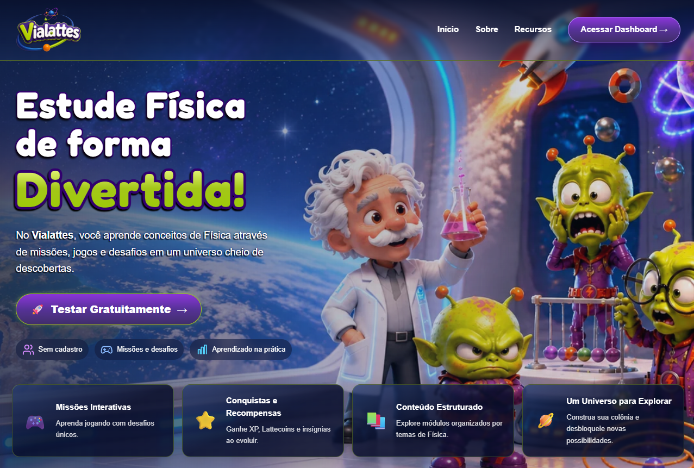
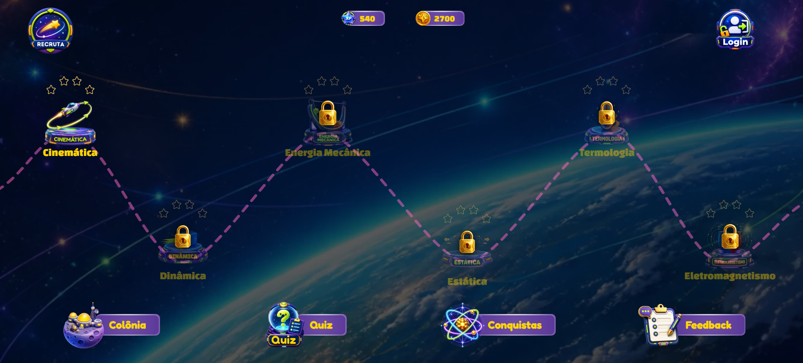
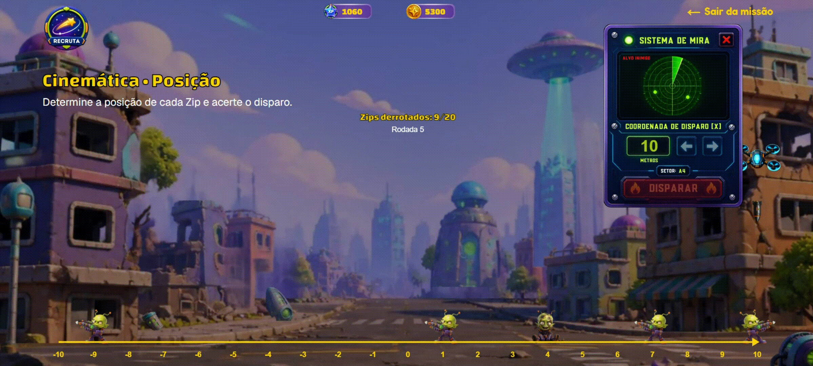
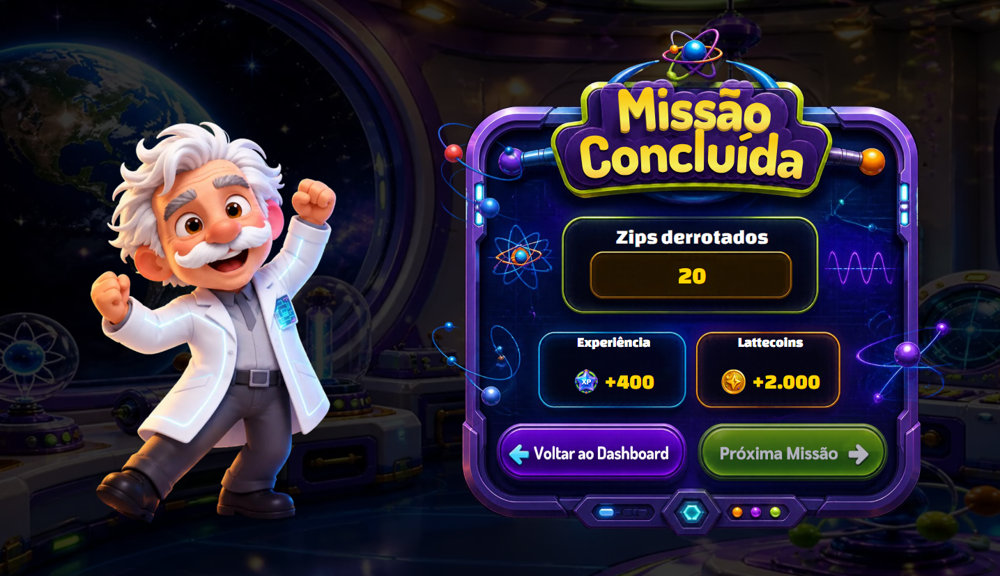

<div align="center">

# 🚀 Vialattes

### Plataforma web gamificada para o ensino de Física

**Aprenda Física enquanto participa de uma aventura intergaláctica!**

O **Vialattes** é uma plataforma educacional desenvolvida pela **Mesora Software** que combina conceitos de Física, gamificação e uma narrativa de ficção científica para proporcionar uma experiência de aprendizagem interativa.

[**🌐 Acessar o protótipo**](https://www.vialattes.com) • [**📚 Documentação técnica**](./docs/README.md)

</div>

---

## 📖 Sobre o projeto

O Vialattes é uma aplicação web educacional voltada ao ensino de Física para estudantes do ensino médio.

A plataforma apresenta uma narrativa de invasão alienígena na qual os estudantes assumem o papel de recrutas responsáveis por enfrentar desafios utilizando conhecimentos de Física.

Ao longo da jornada, os participantes são orientados pelo **Professor Leonardo Lattes**, personagem responsável por contextualizar os conteúdos e acompanhar o desenvolvimento das missões.

A proposta utiliza elementos de gamificação, como pontos de experiência (XP), moedas virtuais (*lattecoins*), patentes e recompensas, buscando tornar a interação com os conteúdos mais envolvente.

O projeto encontra-se em desenvolvimento, e sua versão atual corresponde a um **protótipo funcional**, criado inicialmente no contexto de um Trabalho de Conclusão de Curso em Engenharia de Software.

---

## 🎮 Demonstração do protótipo

O protótipo apresenta a identidade visual da plataforma, a navegação entre suas principais interfaces e uma missão interativa dedicada ao conceito de posição na Cinemática.

### 🏠 Página inicial

A página inicial apresenta o universo do Vialattes e permite acessar o ambiente da plataforma.

<div align="center">



</div>

### 🛰️ Dashboard

O dashboard reúne os módulos de aprendizagem, os indicadores de progressão e os principais recursos de navegação.

A interface apresenta elementos de gamificação, como pontos de experiência (XP), *lattecoins* e patentes, que integram a proposta de evolução do estudante.

<div align="center">



</div>

### 🎯 Missão Posição — Cinemática

A missão **Posição** introduz o conceito de localização de um objeto em um referencial unidimensional.

O estudante controla um drone ao longo de um eixo horizontal, utilizando os comandos disponíveis para modificar sua posição e interagir com o sistema de mira.

A atividade integra elementos visuais e interativos a um conceito fundamental da Cinemática.

<div align="center">



</div>

### 🏆 Conclusão da missão

Ao concluir o desafio, o estudante recebe uma confirmação visual de que a missão foi finalizada.

Essa interface integra o sistema de feedback e progressão previsto para a experiência gamificada.

<div align="center">



</div>

> **Nota:** as imagens e a animação representam o protótipo funcional. Algumas interfaces e indicadores demonstram elementos planejados para a plataforma, sem necessariamente possuir integração com serviços de backend ou persistência de dados.

---

## ✨ Funcionalidades implementadas

O protótipo atual contempla:

- **Página inicial:** apresentação da plataforma e acesso ao ambiente educacional.
- **Dashboard:** visualização dos módulos de aprendizagem, indicadores de progressão e elementos de navegação.
- **Navegação entre interfaces:** acesso às principais páginas previstas na estrutura da aplicação.
- **Missão Posição:** atividade interativa relacionada ao conceito de posição em um eixo unidimensional.
- **Controle do drone:** movimentação horizontal por meio do teclado e dos controles disponíveis na interface.
- **Painel de mira:** interface interativa utilizada durante a execução da missão.
- **Feedback de conclusão:** apresentação visual do encerramento da missão.

A implementação atual concentra-se no frontend. Os indicadores de progressão e demais elementos associados ao perfil do estudante ainda não possuem persistência de dados.

---

## 🛠️ Tecnologias utilizadas

O frontend do Vialattes foi desenvolvido utilizando as seguintes tecnologias:

| Tecnologia | Finalidade |
|---|---|
| **Next.js** | Framework para desenvolvimento da aplicação web |
| **React** | Construção de interfaces baseadas em componentes |
| **TypeScript** | Desenvolvimento com tipagem estática |
| **Tailwind CSS** | Estilização das interfaces |
| **Zustand** | Gerenciamento de estado |
| **Framer Motion** | Animações e transições de interface |
| **React Hook Form** | Gerenciamento de formulários |
| **Zod** | Definição de esquemas e validação de dados |
| **shadcn/ui** | Componentes de interface |

A arquitetura utiliza o **Next.js App Router**, com organização modular dos componentes e das páginas.

O projeto também adota uma estrutura de monorepo para facilitar sua evolução.

---

## 📁 Estrutura do projeto

A organização geral do repositório é apresentada a seguir:

```text
vialattes/
├── apps/
│   └── frontend/          # Aplicação web Next.js
│
├── docs/
│   ├── images/            # Imagens e demonstrações do projeto
│   ├── uml/               # Diagramas UML
│   └── README.md          # Documentação técnica
│
├── README.md              # Apresentação principal
└── ...
```

A documentação UML é mantida separadamente do código-fonte, permitindo consultar os artefatos de modelagem e acompanhar a evolução da arquitetura.

---

## 📚 Documentação técnica

O Vialattes foi desenvolvido a partir de atividades de levantamento de requisitos, modelagem UML, prototipação e implementação.

A documentação disponibilizada no repositório contempla:

- **Diagramas de casos de uso:** representação das funcionalidades e interações previstas.
- **Diagramas de atividades:** descrição dos fluxos de execução das funcionalidades.
- **Diagramas de sequência:** representação das interações entre os componentes do sistema.
- **Diagrama de classes:** modelagem conceitual das entidades e de seus relacionamentos.

Parte dos diagramas representa funcionalidades previstas para etapas posteriores, especialmente aquelas relacionadas à autenticação, persistência de dados e serviços de backend.

**➡️ [Acessar a documentação técnica completa](./docs/README.md)**

---

## 🚧 Estado do desenvolvimento

O Vialattes encontra-se em desenvolvimento incremental.

A versão atual constitui um protótipo funcional voltado à demonstração da proposta visual, da navegação e da interação em uma missão de Física.

### Implementado

- Interfaces principais do protótipo.
- Navegação entre páginas.
- Dashboard com elementos visuais de gamificação.
- Missão interativa de Cinemática.
- Sistema de movimentação e mira.
- Interface de conclusão da missão.

### Planejado para etapas futuras

- Implementação dos serviços de backend.
- Autenticação e gerenciamento de usuários.
- Persistência de dados e progresso individual.
- Ampliação dos módulos e das missões de Física.
- Implementação completa dos sistemas de recompensas e conquistas.
- Integração das funcionalidades de gamificação.
- Avaliações de usabilidade e estudos com estudantes.

As funcionalidades futuras serão desenvolvidas progressivamente, de acordo com as prioridades técnicas e os resultados das etapas de validação.

---

## 🎓 Contexto acadêmico

O protótipo inicial do Vialattes foi desenvolvido como parte de um **Trabalho de Conclusão de Curso (TCC) em Engenharia de Software**, no Centro Universitário Internacional UNINTER.

O trabalho abordou o desenvolvimento de uma aplicação web gamificada como proposta de apoio ao ensino de Física no ensino médio.

As atividades envolveram:

1. Levantamento e especificação de requisitos.
2. Modelagem do sistema por meio de diagramas UML.
3. Desenvolvimento de protótipos de interface.
4. Implementação do frontend.
5. Verificação funcional do protótipo.

Os resultados obtidos demonstram a viabilidade técnica de implementar a proposta em uma aplicação web interativa.

Entretanto, **a eficácia educacional da plataforma ainda não foi avaliada empiricamente**. A investigação de seus possíveis efeitos sobre a motivação e a aprendizagem dos estudantes constitui uma oportunidade para trabalhos futuros.

---

## 🏢 Desenvolvimento

**Vialattes** é um projeto desenvolvido pela **Mesora Software**.

A iniciativa integra a proposta de desenvolvimento de soluções tecnológicas e educacionais da empresa, com perspectiva de evolução para uma plataforma comercial.

**Website da aplicação:** https://www.vialattes.com

**Repositório:** https://github.com/mesora-software/vialattes

---

<div align="center">

**Vialattes — Uma nova jornada pelo universo da Física.**

Desenvolvido pela **Mesora Software**.

</div>
